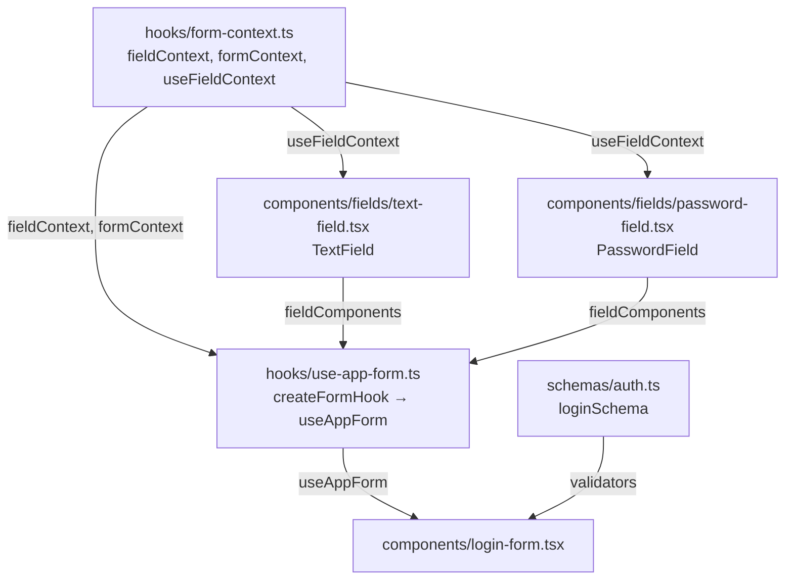
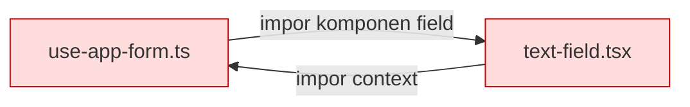
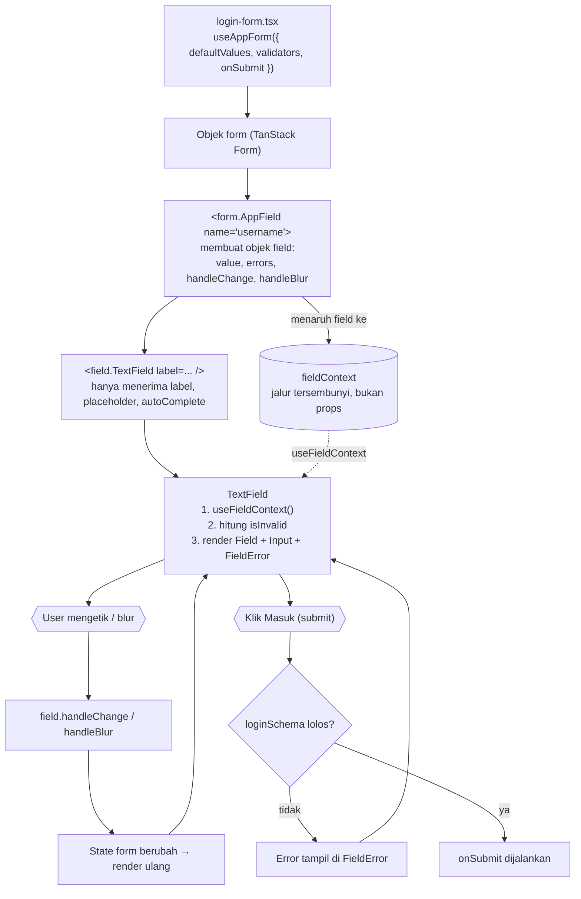
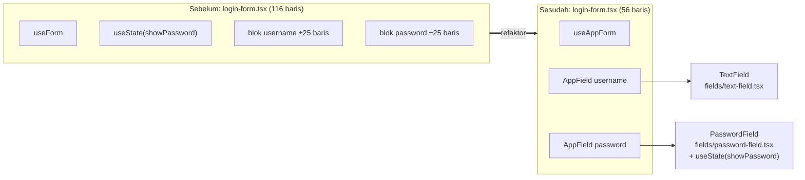

# Diagram: Refaktor Form Login

Pelengkap [refaktor-form-login.md](./refaktor-form-login.md). Untuk melihat diagram
sebagai gambar di VSCode, buka Markdown Preview (`Ctrl+Shift+V`). Diagram Mermaid
didukung bawaan di VSCode versi terbaru; jika tidak tampil, pasang ekstensi
"Markdown Preview Mermaid Support".

---

## 1. Siapa mengimpor siapa

Panah berarti "diimpor oleh". Semua panah searah ke bawah, tidak ada yang melingkar.

### Kenapa `form-context.ts` dipisah?

Jika context ditaruh di `use-app-form.ts`, terjadi impor melingkar:

---

## 2. Alur data saat form berjalan

Poin kuncinya: garis putus-putus. `login-form` tidak mengirim nilai, error, atau
handler lewat props. `TextField` mengambilnya sendiri dari context.

---

## 3. Sebelum dan sesudah

---

## 4. Peran tiap file

| File | Peran |
| --- | --- |
| `hooks/form-context.ts` | Membuat "kabel" penyambung form ke field |
| `components/fields/text-field.tsx` | Tampilan field teks, mengambil data lewat context |
| `components/fields/password-field.tsx` | Sama, ditambah tombol mata dan state `showPassword` lokal |
| `hooks/use-app-form.ts` | Mendaftarkan field ke form, menghasilkan `useAppForm` |
| `components/login-form.tsx` | Memakai `useAppForm` dan merangkai field |
